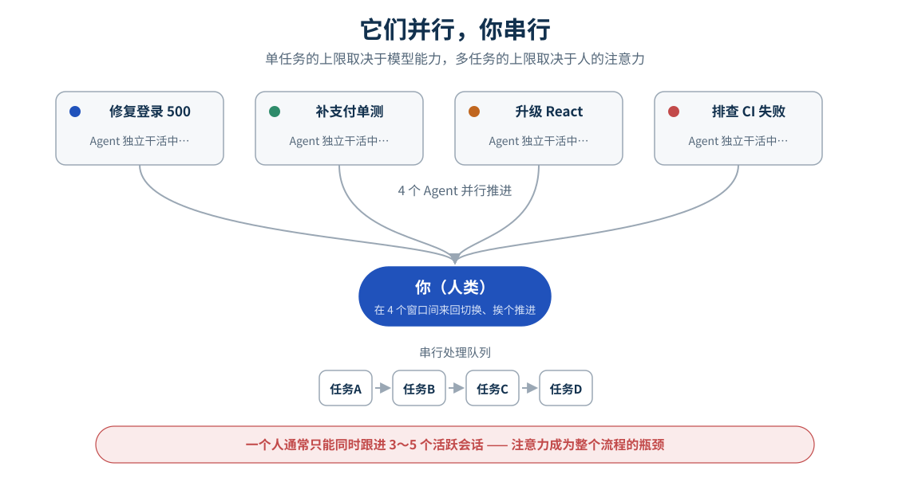
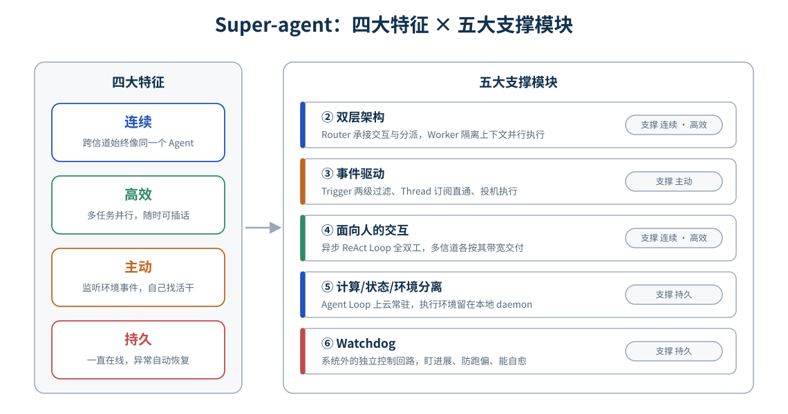
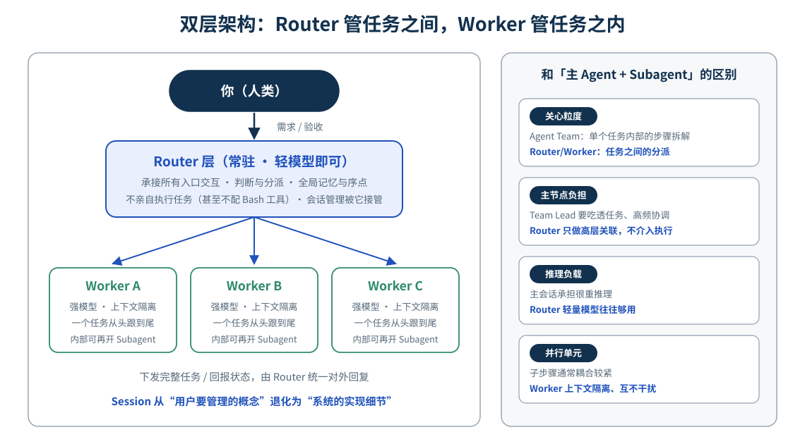
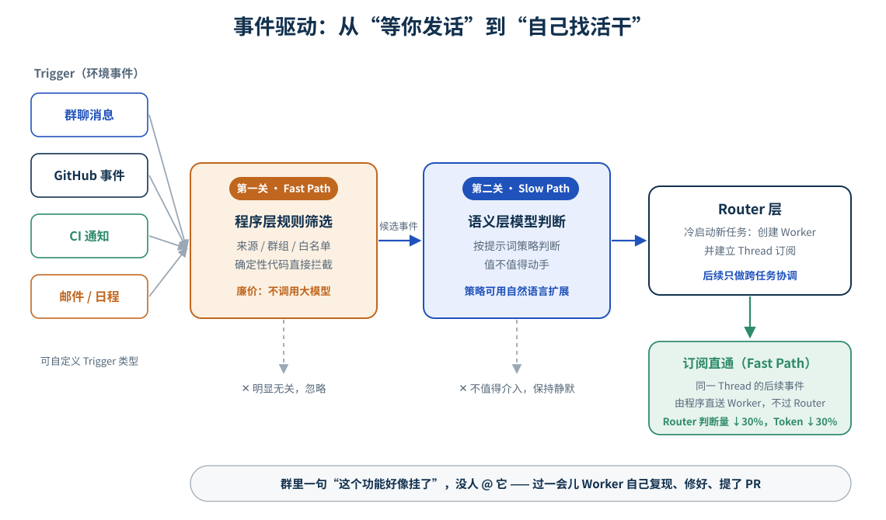
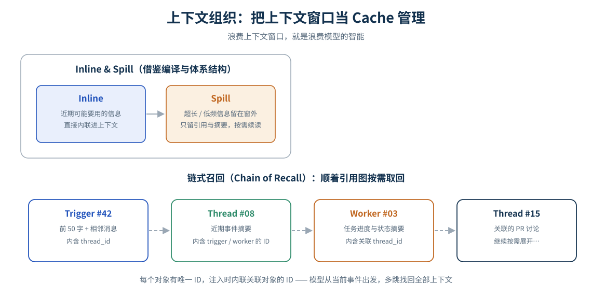
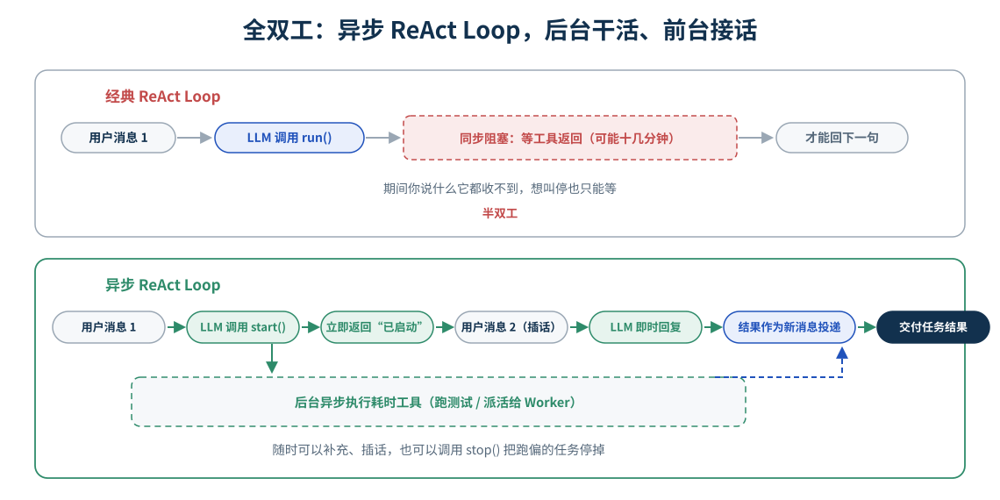
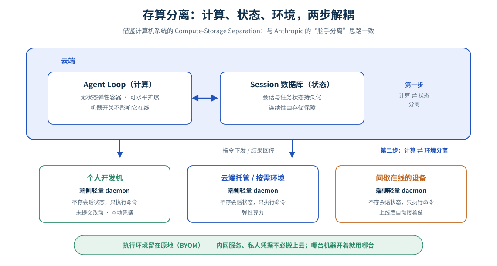
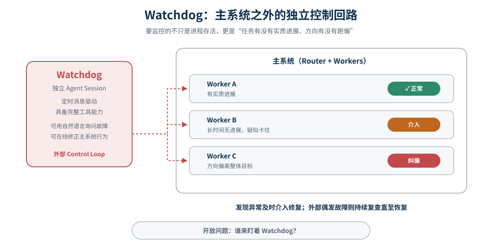
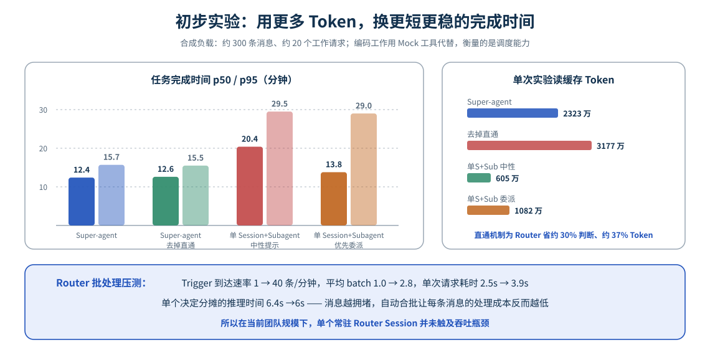

# 从「它们并行、你串行」说起：Super-agent 架构解读与技术思考

> 人的注意力，而不是模型能力，正在成为多 Agent 时代的瓶颈。本文从一条科普视频出发，结合 DeepSeek 开源的 Super-agent 设计长文与全网调研，拆解下一代 Agent 系统的五大模块，并给出我自己的理解与冷静思考。

**约 12 分钟读完 · 9 张原创架构图 · 素材：小白debug 视频 · DeepSeek 设计长文 · 公开报道**

---

最近刷到「小白debug」的一条视频《Super-agent 是什么？》，讲的是 DeepSeek 在 2026 年 10 月 31 日开源的下一代 Agent 方案。视频只有八分多钟，但背后的信息量很大：DeepSeek Harness 团队同日发表了一篇设计长文《Super-agent 设计探索：迈向更自主的 Agent 系统》，并在 GitHub 上以 MIT 协议开源了研究原型 `dsh-superagent-prototype`，48 小时内冲到 GitHub Trending 榜首、收获 9000+ Star。

我把视频、设计长文原文和这段时间的公开报道都读了一遍。这篇文章是我的学习笔记与思考：前半部分拆解这套架构到底设计了什么，后半部分聊聊它在行业里的位置，以及我认为值得借鉴和需要冷静看待的地方。

## 一、痛点：Agent 并行，人串行

这两年模型越来越能打，单个 Coding Agent 已经能独立完成相当复杂的任务，很少需要人插手。于是一个自然的用法出现了：**同时开好几个 Agent，让它们并行干活**。

效率确实上去了，但新的问题随之而来——你自己得在几个窗口之间来回切换，挨个推进它们的工作：看看 A 是不是又问你要确认了，B 的 PR 要不要合并，C 跑偏了没有。**它们并行，你串行。** DeepSeek 团队在长文中给出了一个观察：一个人通常只能同时跟进 3 到 5 个活跃会话。超过这个数，人的注意力就成了整个流程的瓶颈。

这句话值得反复琢磨：**「单任务的上限取决于模型能力，多任务的上限取决于人的注意力。」**现有的主流 Agent 以单一 Session 为基本单位，Session 之间彼此独立。想并行推进多项工作，人就得手动切换并记住每个 Session 的上下文——会话管理这件本该由系统做的事，被压到了人身上。

Super-agent 要解决的正是这个问题：打破 Agent 与单次手动会话的绑定，让它成为一个**能跨会话保持上下文、同时推进多项复杂任务且互不干扰的连续实体**。人的角色则进一步上移——从盯进度、做中转，上移到更高层的决策与验收。

## 二、Super-agent 是什么：四大特征 × 五大模块

先澄清一个容易混淆的点：**Super-agent 不是新模型，也不是一款可以直接订阅的产品**，而是一套 Agent 系统架构，外加一个用来验证技术路线的开源研究原型。它定义了这种 Agent 形态应该具备的四个基础特征：

- **连续**：你可以在 IM 群聊、GitHub 评论等熟悉的工作界面直接和它交互，感觉始终只存在一个 Agent。你在 IM 里说用方案 A，转头在 PR 评论里改成方案 B，它能理解并跟上。
- **高效**：交互响应迅速，能并行、高质量地完成多个复杂任务；不用等上一个任务跑完，就能接受下一条指令。
- **主动**：不需要你逐条下达指令，它持续观察环境事件，主动推进值得处理的事；不需要介入时则保持安静。
- **持久**：始终在线、直接接入真实工作环境，长期运行中遇到异常能自动恢复。

单个 ReAct Loop 无法同时支撑这四个特征，底层需要一套架构。长文给出了五个支撑模块：**双层架构**（兼顾连续与高效）、**事件驱动**（实现主动）、**面向人的交互**（交互层面的连续与高效）、**计算/状态/环境分离** 与 **Watchdog**（实现持久）。

下面逐个拆解这五个模块。值得一提的是，长文作者很坦诚：这套设计「并没有提出全新的理论，而是将计算机系统中经典的工程思想应用到了 Agent 系统的构建中」。看的过程中你会发现，到处都是以快路径/慢路径、发布订阅、批处理、异步 IO、存算分离、看门狗这些老朋友的影子——这也是我觉得它值得认真研究的原因。

## 三、双层架构：Router 管任务之间，Worker 管任务之内

要同时做到「跨信道连续」和「多任务高效并发」，系统在会话组织上面对一个根本权衡：

- 所有事件都交给**同一个 Session**：上下文最连续，但单个 ReAct Loop 串行执行，吞吐低，多任务的中间细节还会互相污染。
- 每个事件都**新开独立 Session**：并发最高，但缺少全局上下文，结果彼此割裂，多个会话各自回复用户也会造成混乱。

解法是经典的「加一层中间层」：把「维护全局连续性」和「高并发执行」拆到两层——

- **Router 层（常驻）**：统一承接所有入口的人类交互，做判断与分派，充当全局的序点、协调点和记忆。它**不亲自执行具体任务**（甚至可以不配 Bash 工具），所以用较轻量的模型往往就能兼顾速度与效果。
- **Worker 层（上下文隔离）**：每个 Worker 挂载完整执行工具，在独立上下文中把一个任务从头跟到尾，直接决定交付质量，因此配最强的模型。Worker 不与人类直接交互，只向 Router 汇报状态，由 Router 统一对外回复。

### 和「主 Agent + Subagent」有什么区别？

这是最容易问的问题，长文里讲得很清楚：常见的 Agent Team（主 Agent + 几个 Subagent）解决的是**单个复杂任务内部**的步骤拆解与角色协作，子步骤耦合紧，Team Lead 要吃透任务细节、高频协调，自己承担很重的推理负载；而 Router 层只处理**任务之间**的高层关联与分派，不介入单任务内部。反过来，如果你用提示词约束一个 Agent Team 的主会话「不许亲自干活、只做对外交互和分派」，它其实就近似这种双层架构了——区别在于 Super-agent 把这个约束做进了系统层，而不是依赖提示词和模型的临场自觉（后面的实验数据会证明这个差别有多大）。

Worker 内部也不是铁板一块：执行复杂任务时它可以再开 Subagent，甚至自己就是一个 Agent Team，对上层透明。这种「Router 管任务之间、Worker 管任务之内」的权责划分，让架构在两个方向上都能扩展。

> **这一层真正改变的是什么**
>
> 用户侧的体感是：始终在跟同一个 Agent 说话，会话管理被系统接管了。长文里有句话我很喜欢——「让用户手动管理 Session，很大程度上是从底层 LLM API 延续下来的设计惯性；**Session 应当是系统的实现细节，而不应是用户的认知负担**。」

## 四、事件驱动：两级过滤、订阅直通与投机执行

到这里为止，Agent 还是被动的——你不发话，它不动。要让它「主动」起来，驱动方式要变：输入不再是人逐条敲的提示词，而是环境中的半结构化事件。群聊消息、邮件与日程提醒、代码审查评论、CI 结果，这些统称为 **Trigger**。

### 两级过滤：Fast Path / Slow Path

真实环境的事件流是「高噪音、低触发率」的：一个群一天几百上千条消息，绝大多数和 Agent 无关。每条都让大模型判断一次，又贵又慢。这里借鉴了计算机系统中 Fast Path / Slow Path 的思想，分两层筛选：

- **程序层策略（Fast Path）**：按事件来源、群组范围、白名单等确定性条件，用代码快速准入，比如对不同来源分别设置「仅响应明确请求」「作为候选」「直接忽略」，在调用模型前滤掉大部分噪音。
- **语义层策略（Slow Path）**：通过准入的候选事件交给 LLM，按提示词写的策略判断值不值得动手。这一层同时是自然语言扩展点，随时可以用提示词新增或关闭策略。

效果就是：有人在群里随口说了句「这个功能好像挂了」，没 @ 任何人，过一会儿一个 Worker 自己复现、修好，提了个 PR 上来。Trigger 类型也可以自定义——日程提醒、会议邀约邮件，都可以成为唤醒 Agent 的事件源。

### 订阅与直通：给 Router 减负

如果 Worker 提了 PR 之后，这条 PR 下的每条新评论、每个 CI 结果都还要回到 Router 判断「该给谁」，Router 很快就会成为卡点。解法是引入 **Thread**（同一个 PR、同一个话题、同一串邮件构成的连续事件流）和**订阅机制**：

- Router 根据某个 Thread 的初始事件创建 Worker 后，**让 Worker 直接订阅这个 Thread**；
- 此后同串的后续事件由**程序直通**给已订阅的 Worker，不再经过 Router 转发；Router 只负责新任务的冷启动和跨任务协调；
- 订阅是多对多的：一个 Worker 可订阅多个 Thread，一个 Thread 也可被多个 Worker 订阅——多个 Worker 在同一个 PR 里相遇时，靠共享事件流自行发现冲突，而不是点对点通信。

实测数据显示，直通机制让 Router 少做约 30% 的判断，省下约 30%（按实验口径约 37%）的 Token——它不影响任务完成的质量和速度，纯粹是省钱省延迟。

### 投机执行：讨论还在进行，方案已经备好

还有一个视频里没展开、但我觉得很妙的点：**投机执行（Speculative Execution）**。Agent 可以在不确定结果是否会被采用时，根据环境信号在后台提前行动——结果有价值就交付，没价值就丢弃，用额外的后台算力换人的等待时间。长文举的内部例子：用户群里有人讨论「波浪号被误渲染成删除线」，团队还在争论该在训练侧还是渲染侧修，Agent 已经在后台复现并提交了修复 PR，还附上了依据——Pandoc 和 markdown-it 只支持双波浪号，GFM 额外接受单波浪号，而模型输出里单个「~」多用于表示区间，正是误渲染的来源。讨论还没结束，可靠的方案已经摆在桌上了。

## 五、上下文组织：Inline & Spill 与链式召回

事件经过滤和路由进入 Session 后，下一个问题是：往模型的上下文窗口里注入多少信息？注入过多会挤占窗口、稀释注意力；注入过少又迫使模型反复调工具读取，增加执行步数。长文的判断很直接：**「浪费上下文窗口，就是浪费模型的智能。」**

解法是把有限的上下文窗口当 **Cache** 来管理，借用编译优化和体系结构里的两个基本操作：

- **Inline**：近期很可能用到的信息直接内联进上下文，省去工具调用往返——比如消息的前 50 字、IM 里前后相邻的消息、代码评审中相邻的评论；
- **Spill**：超长或低频的完整内容留在窗口之外，窗口内只保留引用或摘要，模型需要时再调工具续读。

把 Inline & Spill 一致地应用到系统里的各类对象后，就自然得到了一种按需展开的多跳检索机制——**链式召回（Chain of Recall）**。系统为 Trigger、Thread、Worker Session 等对象赋予唯一 ID，注入时内联关联对象的 ID，这些对象在底层构成一张引用图。模型可以从当前事件出发，顺着引用关系逐步召回上下文：从一条消息读到所在 Thread，从 Thread 追到负责的 Worker，再从这个 Worker 找到它关联的另一个 PR 讨论。这正是 Router 层在长期运行、积累了大量历史任务后，仍能找回旧任务上下文的关键。

## 六、全双工与多信道交互

### 异步 ReAct Loop：从半双工到全双工

经典 ReAct Loop 里，模型发起一次同步的 `run()` 工具调用后，循环就阻塞了，直到工具执行完返回结果。Worker 跑一整套测试要十几分钟，这期间你再跟它说什么，它都收不到——这是「半双工」。

Super-agent 把耗时操作改成异步的 `start()` / `stop()`，构成**异步 ReAct Loop**：模型调用 `start()` 后立即收到「已启动」的返回，循环不再等待；工具在后台执行完毕后，结果作为一条新的事件消息投递进会话；模型也可以随时调 `stop()` 终止跑得太久或跑偏的任务。前台对话与后台执行解耦，两头同时进行，这就是**全双工**。

Router 把活派给 Worker 同理：派完立刻回你一句「已经开始了」，接着就能听你说下一句；Worker 干完，结果作为新消息送回。你随时能插话、补充边界条件，它也能随时把跑偏的任务停掉。

### 多信道交互：在哪条信道，就说哪种话

不同工作信道的信息密度和使用习惯完全不同。如果把面向单人终端的交互方式直接搬进群聊——冗长的推理过程、密集的工具调用原样输出——在多人协作里就是信息灾难。Super-agent 的做法是：

- 冗长的推理和工具调用隔离在 Worker Session 内部，**只有 Router 对外说话**；
- 针对信道定制交互规范：**IM 里像人类同事一样低打扰**，只在需要决策或验收时通知，只问直接问题、给简短结论（团队验证过的一条有效硬规则：单次回复不超过 100 词）；**GitHub、邮件等异步信道则侧重结构化、高信息密度的交付**，比如按项目规范写完整的 PR 背景、改动说明和验证结果。

## 七、存算分离：计算、状态与环境的两步解耦

本地 Agent 把推进 Agent Loop 的「计算」、需要持久保存的会话「状态」、代码仓库与工具链等执行「环境」，全绑在一台机器上——机器一休眠，Agent 就停了，也用不了别的机器。要做到持久在线，借鉴存算分离（Compute-Storage Separation）思想，分两步解耦：

- **第一步：计算与状态分离。**推进 Agent Loop 的计算做成无状态的，放进云端弹性容器（可水平扩展、可重启替换）；会话等持久化状态存进数据库。Agent 由此摆脱单机生命周期，实现云端持续在线。
- **第二步：计算与执行环境分离。**命令最终还得在真实环境上跑，而真实环境里有未提交的本地改动、只有内网能连的服务、一堆私人凭据——把这些搬上云又贵又容易漏。所以环境留在原地，每台机器只部署一个**不保存会话状态的轻量 daemon**，听云端指令、在本地跑命令、把结果传回去。

这个思路和 Anthropic 提出的「脑手分离」（Decoupling the brain from the hands）一致——都让 harness 保持无状态、会话日志存在 harness 之外。区别在于场景：Anthropic 那篇讲的是托管沙箱与客户 VPC，而这里首先要接入的是**用户日常使用的、可能间歇在线的个人机器**（BYOM，Bring Your Own Machine）。你合上笔记本，它照样在群里接活、在别的机器上干活；需要你笔记本才能做的事，等它重新上线再自动接着做。

## 八、Watchdog：主系统之外的独立控制回路

Worker 长期在云上跑，时间一长难免出问题——但注意，很多异常不是进程崩溃，而是**模型陷入无效循环或方向跑偏**，传统的进程存活探测根本发现不了。所以需要在主系统之外引入一个独立的外部控制回路（Control Loop）：

- 一个独立的 **Watchdog Session**，由定时消息驱动，定期醒来做一轮检查；
- 除了处理接口报错、状态恢复失败等基础设施故障，它还用模型判断**每个 Worker 有没有实质进展、方向有没有偏离整体目标**，发现异常及时介入修复；
- Watchdog 本身也是具备完整工具能力的 Agent Session：维护者可以用自然语言问它故障原因，甚至让它在线修正主系统的行为，比如增删提示词、调整触发规则。

视频结尾留了个有趣的开放问题：**Watchdog 盯着 Worker，那谁来盯着 Watchdog？**这个问题没有标准答案——也许是用更简单的确定性程序盯着它（越往外层，逻辑应该越简单），也许是多个 Watchdog 互相监督，也许最终还是要保留人的定期巡检。长文里更系统的开放问题清单，我们在结语再谈。

## 九、实验数据怎么看

长文第七章给出了两组初步实验，我认为读的时候要注意口径——**它们衡量的是调度与协作能力，不是写代码的能力**：编码工作是用一个只消耗时间的 Mock 工具代替的，负载是合成的（约 300 条消息，其中约 20 条是工作请求，其余是闲聊、跟进、叫停和 CI 消息），每种方案重复 5 次。

### 消融实验：双层架构 vs 单 Session + Subagent

| 方案 | 任务完成时间 p50 / p95（分钟） | 单次实验读缓存 Token |
| --- | --- | --- |
| **Super-agent** | **12.4 / 15.7** | 2323 万 |
| Super-agent（去掉直通） | 12.6 / 15.5 | 3177 万 |
| 单 Session + Subagent（中性提示） | 20.4 / 29.5 | 605 万 |
| 单 Session + Subagent（提示优先委派） | 13.8 / 29.0 | 1082 万 |

几个值得注意的点：

- 中性提示下，单 Session 方案 5 次运行里**一次都没有调用 Subagent**，所有工作都在主会话里做、不断被新消息打断，p95 拖到 29.5 分钟；改成「优先委派」提示后 4 次进行了委派，但仍有一次它判断「活很小」自己干了，拖出长尾。**靠提示词约束分工是不稳定的，把约束做进系统层才稳定**——这正是双层架构的价值。
- Super-agent 的代价是 Token：多会话架构单次实验读缓存 Token 2323 万，约为单会话方案的 4 倍。**本质上是用更多 Token 换更短、更稳定的完成时间。**
- 去掉直通后完成时间几乎不变，但 Router 的决定数增加约 30%，Token 涨约 37%——直通机制是纯粹的效率优化。

### Router 批处理压测：越堵越便宜

Router 正忙的时候，新来的 Trigger 先攒着，等手上这批判断完，把攒下的合并进一次调用——这就是批处理（Batching）。压测中 Trigger 到达速率从每分钟约 1 条提升到约 40 条：平均 batch 大小从 1.0 升到 2.8，单次请求耗时只从 2.5 秒涨到 3.9 秒（因为合并后的长输入在 Prefill 阶段并行计算），于是**单个决定分摊的推理时间从 6.4 秒降到 1.6 秒**——消息越拥堵，每条消息的处理成本反而越低。这也解释了为什么当前团队规模下，单个常驻 Router Session 并未触及吞吐瓶颈，不需要过早做水平切分。

## 十、开源原型与落地现状

配套开源的 `dsh-superagent-prototype`（MIT 协议，TypeScript 编写）是 DeepSeek Harness 的一个插件包，定位为「面向单个 GitHub 仓库的主动式编码智能体」：持续监听仓库的 Issue、PR 和评论（可选接入飞书），被授权成员 @ 它提需求后，系统创建一个工作项（Ticket），在独立的会话和独立的工作目录里干活，最后回到原对话交付——通常是一个 PR。还有一个网页面板，集中列出所有需要人处理的事项。

几个值得知道的落地细节：

- **「注意力税」哲学**：README 和设计文档里反复强调一条原则——「占用尽可能少的人类注意力，交付尽可能多的实际价值」。每条消息、每个提问、每个通知都要交「注意力税」，交不出对应价值就砍掉。主动工作模式分 `off` / `observe` / `auto` 三档，**出厂默认锁在 observe**：只在日志里记录「如果允许，我刚才准备接这个活」，不擅自动手。
- **克制的自动化边界**：默认只允许为由工单开启、增删合计少于 200 行且已获批准的 PR 自动合并，且不以 Agent 自己的账号开启自动合并。
- **原型边界要说清**：README 置顶声明这是研究原型、不是正式产品，代码与内部版本及设计长文并不完全一致（存算分离、Watchdog 等部分设计尚未完全落地），「may still contain bugs」。第三方实测的反馈也一致：架构设计广受认可，但安装和容错还比较粗糙，且 Worker 以操作者的系统用户身份、较高权限运行命令——官方建议用独立系统账号隔离，不建议直接接进生产仓库。
- **部署有门槛**：需要 Node.js 22.19+、pnpm、git、tmux、Python、GitHub CLI 和配置好模型的 DeepSeek Harness 环境，还需要为 Agent 准备专用 GitHub 账号。官方推荐的安装方式本身就很「Agent 原生」：把仓库克隆下来，对你手头的 Coding Agent 说一句「读一下 SETUP.md，帮我装好」。

长文里还有两个内部真实案例，能看出这套系统的实际运转状态：一是有用户在群里提「字体分开配置」的需求，维护者 @ 了一下，Super-agent 提交 PR 后，在群聊和 GitHub 之间来回切换跟进评审意见（字号分别配置、折叠控件、分区合并），直到 PR 合并；二是它在公共用户群里静默监听时，主动定位了一个 Electron 桌面端「窗口未聚焦时点击被识别为双击」的缺陷根因（Electron 默认吞掉激活窗口的那次点击，下一次点击带 `detail=2`），附带前后对比截图提交了修复 PR。

## 十一、行业视角：不是孤例，「调度层」成为新战场

把镜头拉远，Super-agent 并非孤立的点子。2025 年下半年到 2026 年，「多 Agent 的调度与编排」几乎成了所有头部玩家共同的战场：

- **Anthropic**：Claude Code 在 2026 年 2 月推出 Agent Teams（Team Lead + 共享任务看板 + 成员间点对点通信），9 月重启 Projects 支持多条 thread 并行、由 coordinator 统一调度，10 月其管理智能体又上线动态工作流，官方演示单次并行调度上千个 Agent；
- **OpenAI**：Codex 推出 Dots，Grok 给 bot 加了主 Bot，思路同样是把「盯会话」的工作从人手里收走；
- **Cursor**：2.0 版本支持最多 8 个 Agent 在独立 Git worktree 中并行工作；
- **通用 Agent 一侧**：Manus（2025 年 12 月被 Meta 以 20 亿美元收购）在 2.0 里走向「人格化数字同事」，Genspark 干脆把自己的通用 Agent 产品直接命名为 Super Agent——同一个名字，不同的物种。

大家想解决的是同一个矛盾：**AI 能同时完成的任务越来越多，人类管理这些任务的注意力却没有同步增长。**差异在于切入点：Claude Code / Cursor 从 IDE 和终端里的「单任务并行化」往上长；Manus / Genspark 从「个人全能助理」往下沉；而 DeepSeek 这篇长文选择把问题抽象到系统架构层——不谈产品功能，只谈「一个持续在线、并发响应环境事件的 Agent 系统应该长什么样」，并且明确指出：无论个人助手还是研发协作，**相似的设计约束会导出相似的架构选择**。

顺带提醒一个容易混淆的点：Genspark 的「Super Agent」是一个面向终端用户的产品，DeepSeek 的「Super-agent」是一套开源的架构概念与研究原型——名字相同，层级不同，前者是产品层的交付物，后者是系统层的设计图。

## 十二、我的三点思考

### 1. Agent 系统正在重演操作系统与分布式系统的经典课程

通读长文，最有意思的不是某个具体机制，而是它处处在向计算机系统的经典思想「致敬」：事件过滤是网络栈的 Fast Path / Slow Path；订阅直通是发布订阅与事件路由；批处理是 IO 调度里的合批；全双工是异步 IO；存算分离是云原生数据库的 Compute-Storage Separation；Watchdog 是分布式系统的外部控制回路；Inline & Spill 是 Cache 管理；投机执行直接借用了 CPU 的名字。这些不是巧合——当 Agent 从「一次问答」变成「长期在线、并发响应环境的系统」，它遇到的问题就和操作系统、分布式系统当年遇到的问题同构了。对工程师来说，这意味着**系统设计的旧功夫正在变成 Agent 时代的新护城河**：模型能力会趋同，而把模型组织成可靠系统的工程能力不会。

### 2. 「注意力」是被调度的稀缺资源

这套架构最底层的设计哲学，是把人的注意力当成系统里最贵的资源来预算：Router 替人接管会话管理，两级过滤替人挡掉噪音，直通机制给 Router 自己减负，全双工让人随时插话而不必等待，多信道规范约束它「在该安静的信道保持安静」，observe 默认模式确保它不乱动，「注意力税」原则砍掉一切交不出价值的打扰。如果说操作系统调度的是 CPU 时间片，那么 Super-agent 这类系统调度的就是人的注意力——而且和 CPU 不同，注意力无法扩容、无法抢占恢复，只能被保护。我个人判断，**「每交付一份价值消耗多少人的注意力」会成为衡量 Agent 产品的核心指标**，就像当年我们衡量软件的响应时间和资源占用一样。

### 3. 值得借鉴，也要冷静看待

> **几个不能忽略的「但是」**
>
> ① 实验是合成负载、Mock 工具、厂商自报口径，验证的是调度能力而非交付质量，尚无第三方独立验证；② 多会话架构以约 4 倍 Token 换更短更稳的完成时间，规模化使用时成本要算清楚；③ 原型以用户系统权限执行命令，官方自己都在开放问题里承认：云端 Agent Loop 一旦被入侵或提示词注入攻破，连接的全部端侧设备都面临被控制风险，「让 Agent 在不接触凭据本身的情况下使用凭据」仍是未解之题；④ 存算分离、Watchdog 等设计在开源原型里尚未完全落地。

所以我的建议是：**把它当一张高质量的架构蓝图来读，而不是一个能直接上生产的产品来装。**双层权责划分、两级过滤、订阅直通、注意力预算这些思想，哪怕你不用 DeepSeek 的代码，也完全可以搬进自己的 Agent 系统里。

## 结语与开放问题

回到开头那个痛点。Super-agent 给出的回答是：用一个常驻的 Router 承接你所有的交互，让一群上下文隔离的 Worker 并行干活；用事件驱动让它自己找活，用订阅直通和批处理让它扛住消息洪峰，用全双工让你随时插话，用存算分离让它永远在线，用 Watchdog 替你看场子。你一个人顾不过来的那些会话，现在有一个「超级管家」替你管着——你只需要在关键处做决策、做验收。

长文最后也坦诚地列了一批开放问题，值得每个想建这类系统的人思考：

- **规模上去之后怎么办**：Router 层何时需要水平切分、粒度如何划分，Worker 之间何时需要直接通信；跨月级的长程记忆是主要瓶颈；
- **脱离 Session 之后如何协作**：当底层会话不再对应界面上的会话，项目管理和交互形式该如何重新设计（聊天窗口中心很可能只是路径依赖）；
- **多个实例之间如何协作**：个人助手与团队 Super-agent 各有权限边界，跨边界的 A2A 通信如何安全可靠；
- **安全与隐私**：事件驱动让 Agent 接触更多不可信输入，云端与端侧的信任链如何守护，凭据如何「可用不可见」。

以及那个来自视频的、更朴素的问题：Watchdog 盯着 Worker，**谁来盯着 Watchdog？**欢迎在评论区聊聊你的看法。

---

## 参考资料

1. 小白debug：《Vibe知识大赏 ｜ Super-agent 是什么？》，抖音，2026-11-03。（本文的缘起，概念科普部分的主要参考）
2. DeepSeek Harness 团队：《Super-agent 设计探索：迈向更自主的 Agent 系统》，2026-10-31，微信公众号「DeepSeek 产品部」。（四大特征、五大模块与实验数据的原始出处）
3. GitHub 开源原型：[deepseek-ai/dsh-superagent-prototype](https://github.com/deepseek-ai/dsh-superagent-prototype)（MIT 协议）。
4. 36氪：《DeepSeek 发布超级 Agent，给出了他们对团队合作 Agent 和 Always-on Agent 的解法》，2026-11-03。
5. 动点科技：《DeepSeek 团队开源编程智能体原型，可从 GitHub 和飞书接单》，2026-11-02。
6. Anthropic Engineering：*Decoupling the brain from the hands*（「脑手分离」，存算分离部分的对照阅读）。

---

*说明：本文为技术学习笔记，文中 9 张架构图均为作者依据公开资料重绘的原创示意图；实验数据来自 DeepSeek 官方设计长文（合成负载、厂商口径），引用请注明出处。视频与设计长文的版权归原作者及 DeepSeek 所有。*
